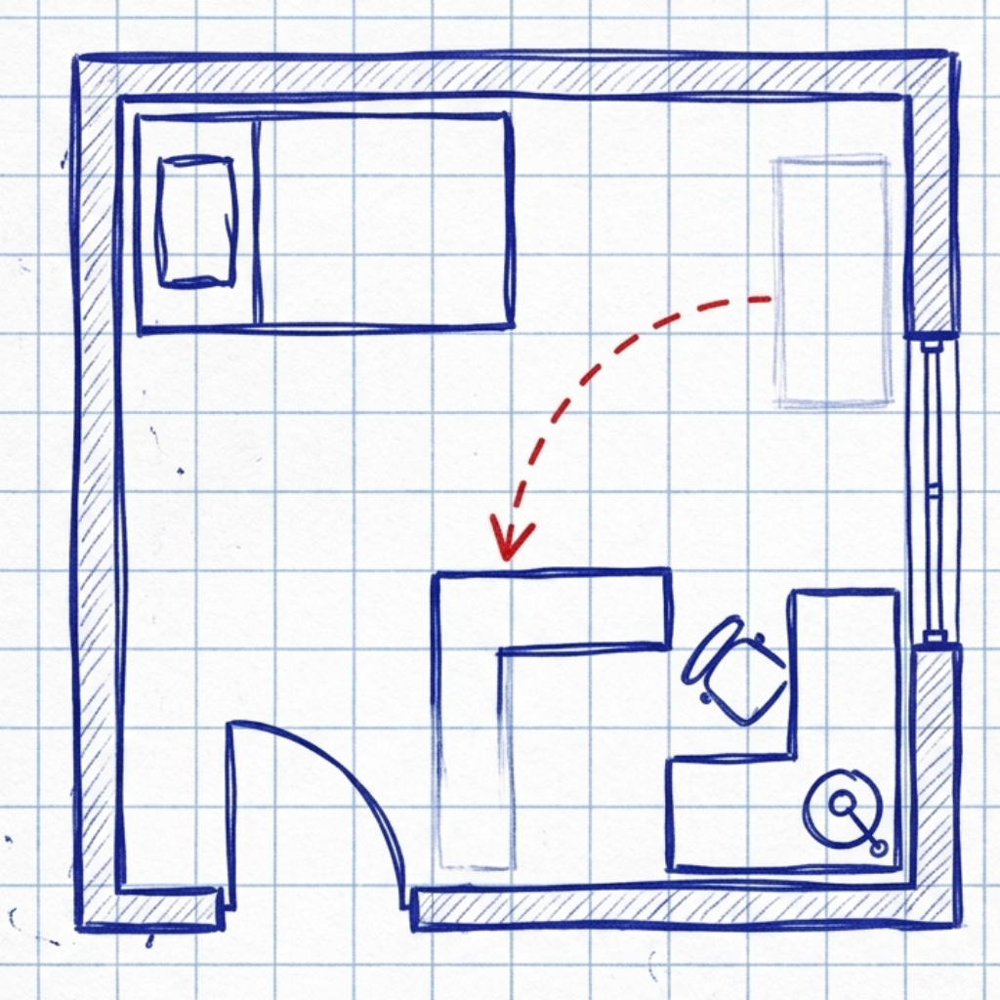
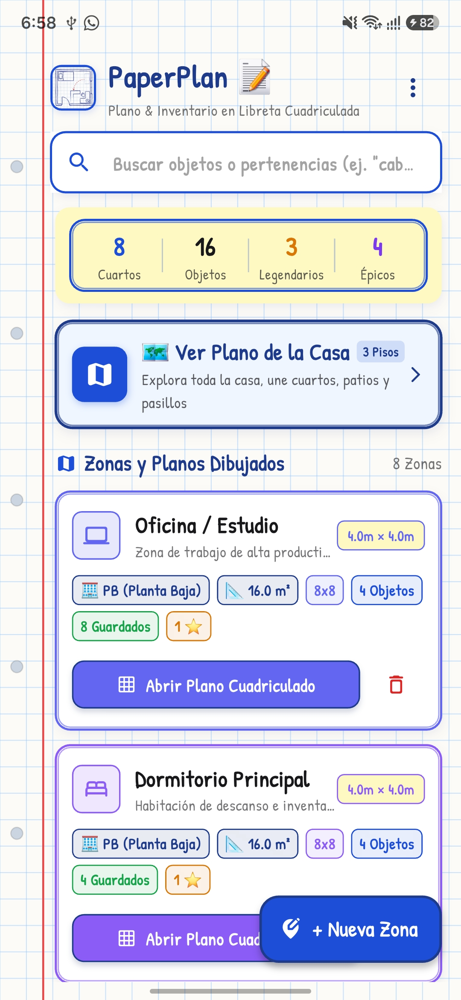
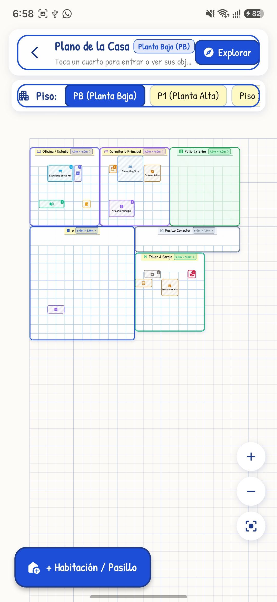
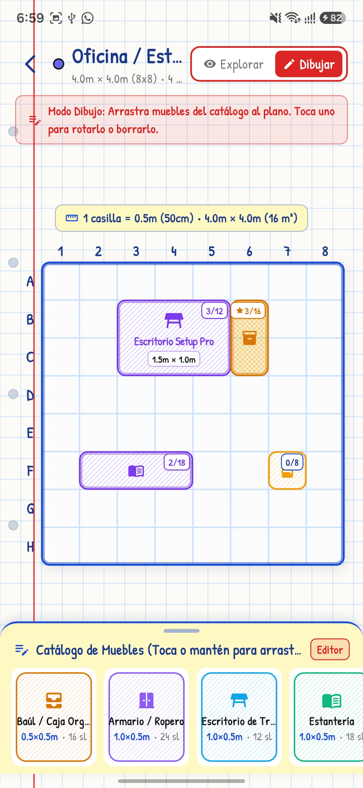
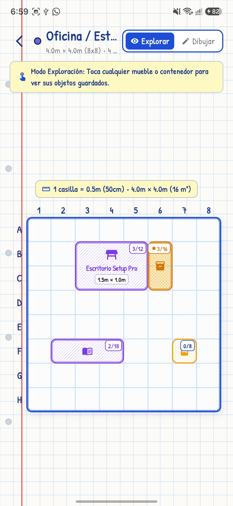
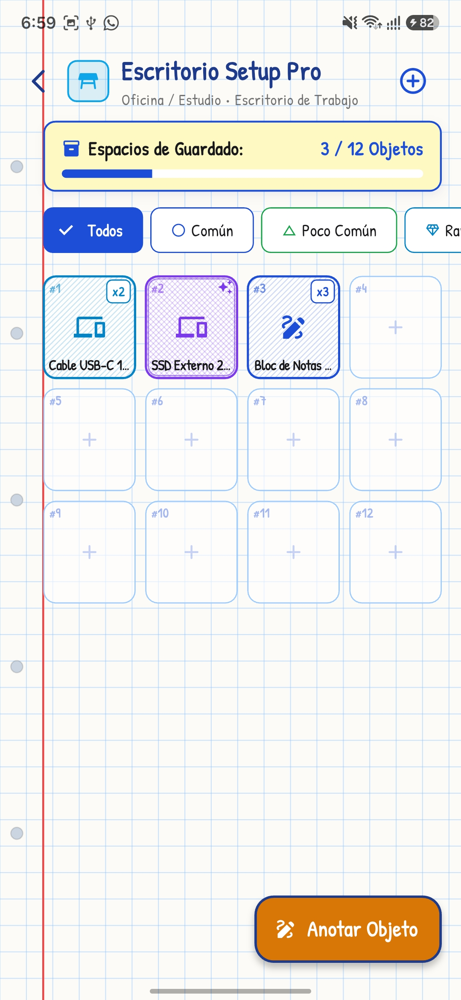
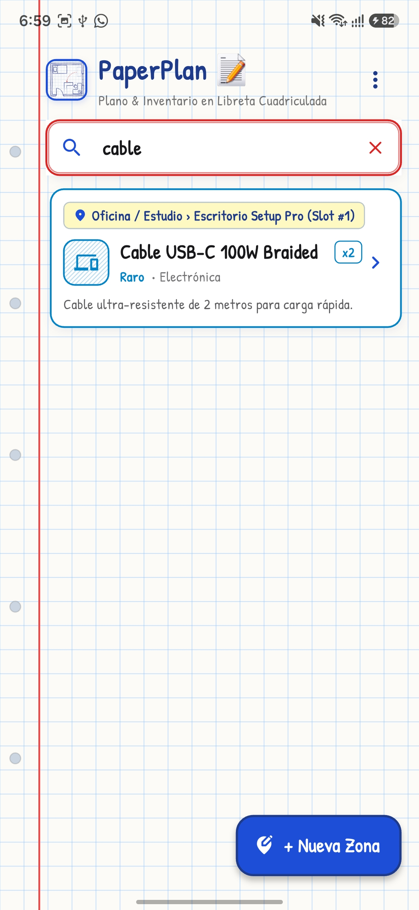

<div align="center">

  

  # 📝 PaperPlan (Loot Room)
  ### *Tu hogar organizado como un inventario de RPG en papel cuadriculado*

  [](https://flutter.dev/)
  [](https://dart.dev/)
  [](https://pub.dev/packages/provider)
  [](https://flutter.dev)
  [](#licencia)

  <p align="center">
    <strong>PaperPlan</strong> transforma la organización de tu hogar en una experiencia interactiva y visual única. Diseña los planos de tus habitaciones, distribuye tus muebles en una cuadrícula milimetrada y guarda tus pertenencias en ranuras de inventario estilo RPG.
  </p>

</div>

---

## 📖 Índice

- [Resumen Técnico](#resumen-técnico)
- [¿Qué es PaperPlan?](#qué-es-paperplan)
- [Estética y Diseño "Notebook Doodle"](#estética-y-diseño-notebook-doodle)
- [Características Principales](#características-principales)
  - [1. Hub Principal y Zonas por Pisos](#1-hub-principal-y-zonas-por-pisos)
  - [2. Plano Arquitectónico de la Casa](#2-plano-arquitectónico-de-la-casa)
  - [3. Diseñador de Habitaciones & Catálogo de Muebles](#3-diseñador-de-habitaciones--catálogo-de-muebles)
  - [4. Modo Exploración vs. Modo Edición](#4-modo-exploración-vs-modo-edición)
  - [5. Inventario de Mueble con Ranuras (Slots RPG)](#5-inventario-de-mueble-con-ranuras-slots-rpg)
  - [6. Buscador Global Instantáneo](#6-buscador-global-instantáneo)
- [Galería de Capturas](#galería-de-capturas)
- [Arquitectura y Tecnologías](#arquitectura-y-tecnologías)
- [Estructura del Proyecto](#estructura-del-proyecto)
- [Instalación y Ejecución](#instalación-y-ejecución)
- [Hoja de Ruta (Roadmap)](#hoja-de-ruta-roadmap)
- [Licencia](#licencia)

---

## Resumen Técnico

> 💼 **Proyecto que demuestra un manejo avanzado de interfaces gráficas nativas en Flutter.**  
> Implementa `CustomPainter` para la estética de trazo a mano, sistemas de cuadrícula con detección de colisiones para la colocación de muebles (*drag-and-drop*), y una gestión de estado global eficiente mediante `Provider`.

### 🎯 Destacados de Ingeniería para Reclutadores & Tech Leads
* 🎨 **Renderizado Procedural con `CustomPainter`**: Creación de un motor visual personalizado para dibujar la textura de papel de libreta, márgenes escolares, perforaciones de carpeta y bordes con efecto de trazo a mano alzada (*doodle art*).
* 📐 **Cuadrícula Interactiva y Detección de Colisiones 2D**: Algoritmo espacial matricial para la manipulación y colocación de mobiliario con previsualización reactiva (*ghost placement* verde/rojo según validez), límites espaciales y soporte para rotaciones de 90°.
* ⚡ **Arquitectura y Estado Global Eficiente**: Gestión del estado reactivo y desacoplado mediante `Provider`, garantizando que únicamente los componentes necesarios se reconstruyan para mantener un rendimiento fluido de 60/120 FPS.
* 💾 **Persistencia de Datos Offline-First**: Serialización, mapeo y almacenamiento local optimizado de estructuras anidadas complejas (`Zonas` ➔ `Muebles` ➔ `Ítems con Slots`) mediante JSON ligero.

---

## ¿Qué es PaperPlan?

¿Alguna vez has olvidado en qué caja del trastero guardaste el cable USB-C, tus pasaportes, las herramientas o una prenda de temporada? 

**PaperPlan** soluciona este problema fusionando:
1. **Modelado espacial 2D**: Planos arquitectónicos de tu casa organizados por niveles (Sótano, Planta Baja, Planta Alta, Patios y Jardines).
2. **Distribución milimétrica**: Ubicación precisa de muebles dentro de cada habitación con escala real calculada (1 celda = 50 cm).
3. **Gestión de inventario de videojuegos**: Cada armario, estantería, cajonera o baúl posee una cuadrícula de ranuras (*slots*) donde cada objeto tiene cantidad, notas, etiquetas y un nivel de **rareza coleccionable**.

---

## Estética y Diseño "Notebook Doodle"

PaperPlan está concebido con un lenguaje visual artesanal inspirado en los bocetos escolares y el juego clásico *Sea Battle 2*:
* 📄 **Papel Cuadriculado y Rayado**: Fondos cálidos con líneas azules de libreta escolar, anillos de encuadernación perforados y margen rojo izquierdo.
* 🖊️ **Paleta de Tintas de Bolígrafo**: Tonos azul clásico Bic (`#1D4ED8`), azul marino (`#1E3A8A`), rojo de anotación (`#DC2626`), verde esmeralda (`#16A34A`), morado gel (`#7C3AED`) y resaltador amarillo neón (`#FACC15`).
* ✍️ **Tipografía Manuscrita**: Utiliza *Patrick Hand* de Google Fonts para dar vida a textos y anotaciones dibujadas a pulso.
* 📐 **CustomPainters Dinámicos**: Trazo imperfecto tipo garabato (*doodle*), sombras a lápiz y bordes redondeados orgánicos.

---

## Características Principales

### 1. Hub Principal y Zonas por Pisos
Centraliza todas las áreas de tu hogar. Organiza tus espacios agrupados por plantas (Sótano, PB, P1) mostrando métricas en tiempo real:
* Cantidad de muebles instalados.
* Capacidad de ranuras ocupadas vs. disponibles.
* Conteo de ítems raros, épicos y legendarios.
* Dimensiones reales en metros cuadrados.

<div align="center">
  
</div>

---

### 2. Plano Arquitectónico de la Casa
Visualiza toda tu propiedad en un lienzo infinito con zoom y desplazamiento suave:
* **Selector de Pisos**: Cambia fluidamente entre pisos superiores, planta baja o subterráneo.
* **Modo Arquitecto**: Mueve y reorganiza la posición de las habitaciones en el plano general.
* Identificación por colores temáticos y accesos rápidos directos a cada zona.

<div align="center">
  
</div>

---

### 3. Diseñador de Habitaciones & Catálogo de Muebles
Personaliza el interior de cada habitación arrastrando muebles desde un catálogo variado:
* **+15 tipos de muebles y elementos**: Armarios, escritorios, estanterías, cajas fuertes, cajoneras, repisas, mochilas, neveras, camas, puertas, ventanas y macetas de jardín.
* **Sistema de cuadrícula inteligente**: Detección de colisiones en tiempo real con indicador "fantasma" verde (válido) o rojo (superpuesto).
* **Herramientas de edición**: Rotación en 90°, ajuste de tamaño y cambio de orientación al instante.

<div align="center">
  
</div>

---

### 4. Modo Exploración vs. Modo Edición
* **Modo Exploración**: Protege el plano contra cambios accidentales y permite interactuar de forma rápida: toca cualquier mueble para abrir su baúl y consultar o retirar objetos.
* **Modo Edición**: Desbloquea la manipulación de muebles, ampliación de dimensiones de la sala y acceso al catálogo completo.

<div align="center">
  
</div>

---

### 5. Inventario de Mueble con Ranuras (Slots RPG)
Cada mueble se comporta como un cofre interactivo de RPG:
* **Capacidad por Ranuras**: Visualiza las ranuras ocupadas y vacías con porcentajes de capacidad.
* **Clasificación por Rarezas**:
  - 🔵 **Común**: Objetos de uso cotidiano (Tinta Azul).
  - 🟢 **Poco Común**: Documentos o herramientas útiles (Tinta Verde).
  - 🔷 **Raro**: Artículos valiosos o de repuesto (Tinta Cyan).
  - 🟣 **Épico**: Joyería, tecnología sensible o colecciones (Tinta Púrpura).
  - 🟡 **Legendario**: Documentación vital, dinero o reliquias familiares (Tinta Dorada / Resaltador).
* **Filtros rápidos por rareza** y detalle modal con cantidades, notas y fecha de guardado.

<div align="center">
  
</div>

---

### 6. Buscador Global Instantáneo
¿No sabes dónde está tu objeto? Escribe su nombre o etiqueta en el buscador superior:
* Búsqueda en tiempo real a través de **todas las habitaciones y muebles**.
* Muestra la ruta de navegación exacta (*Breadcrumbs*):  
  `[Planta / Habitación] › [Mueble] › [Ranura #]`.
* Accede directamente al mueble con un solo toque desde los resultados.

<div align="center">
  
</div>

---

## Galería de Capturas

| Menú Principal | Plano de la Casa | Catálogo de Muebles |
| :---: | :---: | :---: |
|  |  |  |
| **Modo Exploración** | **Inventario y Slots** | **Buscador en Tiempo Real** |
|  |  |  |

---

## Arquitectura y Tecnologías

El proyecto sigue una arquitectura limpia basada en separación de responsabilidades y enfoque **Offline-First**:

* **Core Framework**: [Flutter](https://flutter.dev/) (SDK 3.9+) con [Dart](https://dart.dev/).
* **Gestor de Estado**: [`provider`](https://pub.dev/packages/provider) para propagación de cambios reactivos en el inventario y planos.
* **Persistencia Local**: [`shared_preferences`](https://pub.dev/packages/shared_preferences) para guardado ligero en formato JSON.
* **Tipografía**: [`google_fonts`](https://pub.dev/packages/google_fonts) con la fuente *Patrick Hand*.
* **Generación de IDs**: [`uuid`](https://pub.dev/packages/uuid) para identificadores universales únicos de muebles, zonas y objetos.
* **Iconografía e Identidad**: [`flutter_launcher_icons`](https://pub.dev/packages/flutter_launcher_icons) con diseño personalizado de libreta escolar.

---

## Estructura del Proyecto

```text
loot_room/
├── assets/
│   ├── PaperPlanLogo.png            # Logotipo oficial de PaperPlan
│   └── screenshots/                 # Capturas de pantalla de la aplicación
│       ├── PaperPlan_MenuPrincipal.jpg
│       ├── PaperPlan_PlanoCasa.jpg
│       ├── PaperPlan_AgregarMuebles.jpg
│       ├── PaperPlan_ModoExploracion.jpg
│       ├── PaperPlan_OrganizacionObjetos.jpg
│       └── PaperPlan_Buscador.jpg
├── lib/
│   ├── models/                      # Modelos de datos
│   │   ├── furniture.dart           # Tipos de muebles, dimensiones, slots
│   │   ├── item.dart                # Objetos, rarezas, etiquetas y notas
│   │   └── zone.dart                # Habitaciones, dimensiones y coordenadas
│   ├── providers/                   # Lógica de negocio y estado
│   │   └── inventory_provider.dart  # Provider global (Zonas, Muebles, Búsqueda)
│   ├── screens/                     # Vistas principales de la aplicación
│   │   ├── hub_screen.dart          # Pantalla principal (Lista de habitaciones)
│   │   ├── house_blueprint_screen.dart # Plano arquitectónico 2D interactivo
│   │   ├── zone_canvas_screen.dart  # Lienzo interactivo de habitación y muebles
│   │   ├── chest_inventory_screen.dart # Vista de ranuras de inventario/cofre
│   │   └── search_results_view.dart # Resultados de búsqueda global
│   ├── services/                    # Servicios de almacenamiento y datos
│   │   └── storage_service.dart     # Persistencia local JSON
│   ├── theme/                       # Sistema de diseño
│   │   └── app_theme.dart           # Paleta de papel, tintas y estilos tipográficos
│   ├── widgets/                     # Componentes y pintores personalizados
│   │   ├── doodle_painters.dart     # Fondos de papel cuadriculado, márgenes y trazos
│   │   ├── grid_canvas.dart         # Cuadrícula interactiva con detección de colisiones
│   │   ├── house_room_node.dart     # Nodos de habitaciones para el plano general
│   │   └── inventory_slot_tile.dart # Ranura interactiva estilo cofre RPG
│   └── main.dart                    # Punto de entrada de la aplicación
└── pubspec.yaml                     # Dependencias y configuración de assets
```

---

## Instalación y Ejecución

Sigue estos sencillos pasos para compilar y ejecutar PaperPlan en tu entorno local:

### Prerrequisitos
* Tener instalado [Flutter SDK](https://docs.flutter.dev/get-started/install) (versión 3.9 o superior).
* Tener configurado un emulador Android/iOS o soporte de escritorio (Windows/macOS/Linux).

### Pasos

1. **Clonar el repositorio:**
   ```bash
   git clone https://github.com/tu-usuario/loot_room.git
   cd loot_room
   ```

2. **Instalar las dependencias de Flutter:**
   ```bash
   flutter pub get
   ```

3. **Ejecutar la aplicación:**
   ```bash
   # Para ejecutar en el dispositivo/emulador conectado:
   flutter run

   # O específicamente en Windows desktop:
   flutter run -d windows
   ```

4. **Compilar para producción (Opcional):**
   ```bash
   flutter build apk --release       # Android APK
   flutter build windows --release   # Windows ejecutable
   ```

---

## Hoja de Ruta (Roadmap)

- [ ] 📷 **Fotos de Objetos**: Capacidad de tomar fotos a los artículos para adjuntarlas a la ficha de ranura.
- [ ] 🏷️ **Generador de Códigos QR**: Imprimir etiquetas QR para pegar en cajas físicas y escanearlas desde la app para abrir su inventario al instante.
- [ ] ☁️ **Sincronización en la Nube**: Backup automático y sincronización multidispositivo (Firebase / Supabase).
- [ ] 🌙 **Tema Blueprint / Pizarra Nocturna**: Modo oscuro estilizado como plano técnico en cian sobre azul oscuro.
- [ ] 📦 **Mover Objetos entre Muebles**: Soporte para arrastrar ítems de un cofre a otro directamente.

---

## Licencia

Este proyecto se encuentra bajo la Licencia **MIT**. Consulta el archivo [LICENSE](LICENSE) para más información.

<div align="center">
  <sub>Desarrollado con amor por <strong>Alejandro Santiago Mata (<a href="https://github.com/AlexSantiago25">@AlexSantiago25</a>)</strong>. Pasión por los videojuegos y la organización del hogar.</sub>
</div>
